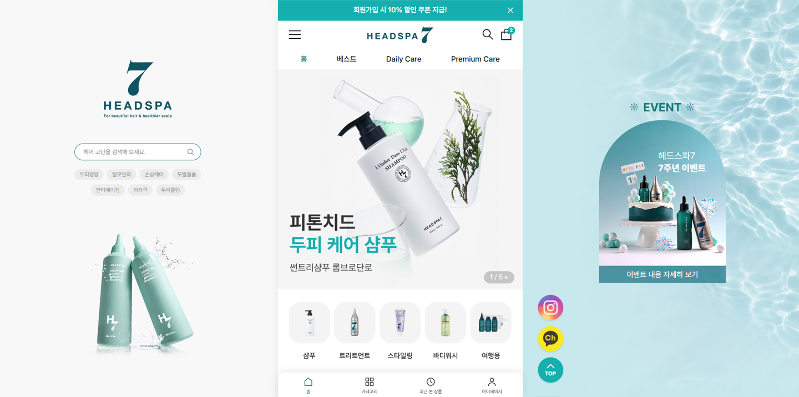
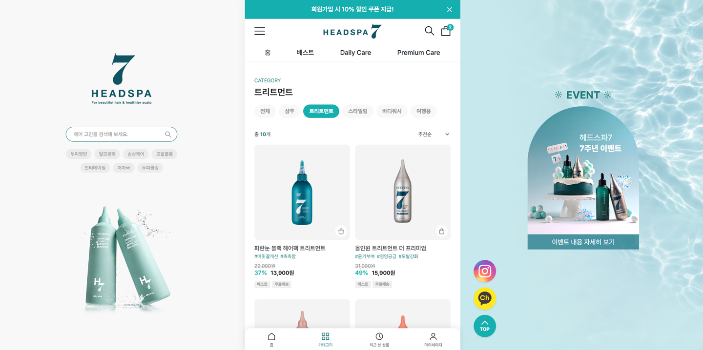
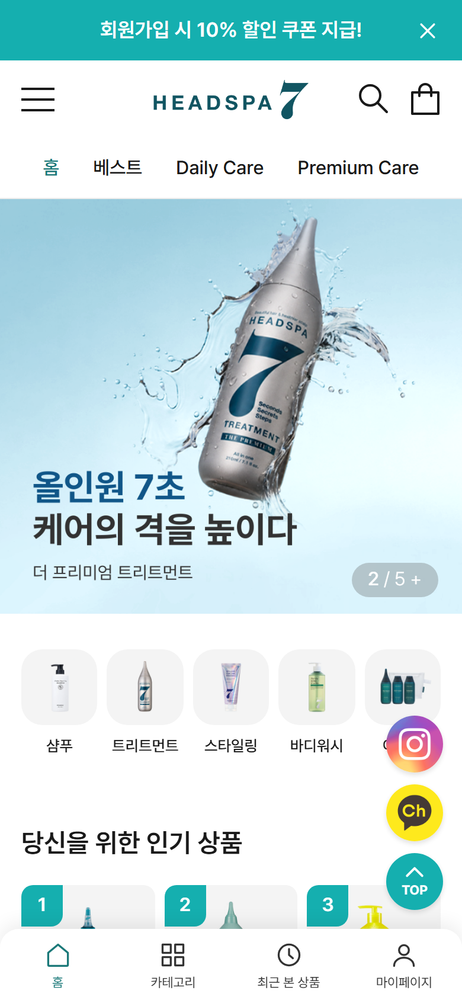
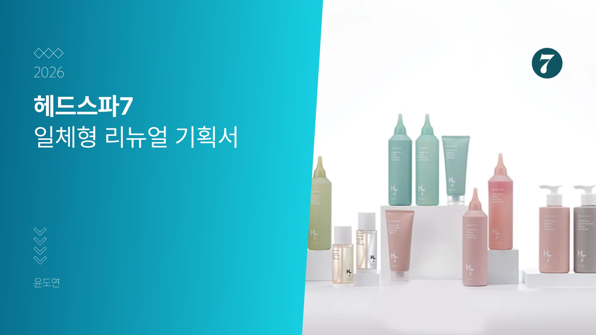

# 헤드스파7 — 쇼핑몰 리뉴얼

>모바일 구매가 중심인 헤어케어 브랜드 헤드스파7의 쇼핑몰 리뉴얼입니다.<br>
>PC에서도 모바일과 같은 일체형 화면을 쓰고, 양쪽 여백은 검색·이벤트 프로모션 공간으로 활용했습니다.

<br>

## 📌 프로젝트 개요

| 항목 | 내용 |
|---|---|
| 프로젝트 구분 | 개인용 포트폴리오 |
| 프로젝트 종류 | 쇼핑몰 리뉴얼 (모바일 중심 반응형 웹사이트) |
| 작업자 | 윤도연 (기여도 100%) |
| 사용 툴 | Figma, Visual Studio Code (React · Vite), Claude Code |
| 작업 기간 | 2026년 11월 4일 ~ 11월 6일 / 작업 기간 3일 (일 평균 5시간, 총 15시간) |

**🔗 사이트 보기: https://headspa7.vercel.app**

<br>



<table>
  <tr>
    <td width="66%"></td>
    <td width="34%"></td>
  </tr>
  <tr>
    <td align="center">PC · 상품 상세</td>
    <td align="center">모바일 · 첫 화면</td>
  </tr>
</table>

> **안내** — 이 저장소는 헤드스파7과 관련 없는 **개인 포트폴리오**입니다.
> 제품 이미지·명칭·상표의 권리는 각 권리자에게 있으며, 실제 제품과 구매는 헤드스파7 공식 스토어에서 확인해 주세요.
> 결제는 토스페이먼츠 **테스트 모드**라 실제로 돈이 나가지 않습니다.

<br>

## 📝 기획서

페이지의 기획 의도와 작업 과정은 기획서에 정리했습니다.<br>
👇 $\color{red}{\textbf{이미지를 누르면 기획서가 열립니다.}}$

<a href="https://canva.link/gtxetmiddpr7tvk"></a>

<br>

## 🎨 디자인 시스템

모든 색과 글꼴은 `src/index.css` 맨 위 `:root`에 토큰으로 정리했습니다.

**컬러 — 밝은 무채색 + 청록 브랜드색**

| 토큰 | 값 | 쓰임 |
|---|---|---|
| `--color-brand` | `#15afaf` | 강조색: 버튼, 선택 상태, 할인율, 쿠폰 |
| `--color-brand-deep` | `#1b7979` | 진한 강조: 소제목, 숫자, 링크 |
| `--color-navy` | `#1d3063` | 보조 포인트색 |
| `--color-text` | `#191919` | 제목 · 본문 |
| `--color-text-sub` | `#333333` | 보조 글자 |
| `--color-text-muted` | `#8e8e8e` | 안내 · 설명 글자 |
| `--color-placeholder` | `#c4c4c4` | 입력칸 안내 글자, 테두리 |
| `--color-surface` | `#f8f8f8` | 페이지 바탕, 상자 면 |
| `--color-white` | `#ffffff` | 가운데 쇼핑몰 화면 바탕 |

**타이포그래피 — Pretendard (포인트 문구만 GmarketSans)**

- 글자 크기는 `.t-` 클래스로 단계를 나눴습니다: `.t-hero`(45) · `.t-promo`(24) · `.t-section`(22) · `.t-nav`(18) · `.t-banner`(17) · `.t-product-name`(16) · `.t-price`(15) · `.t-eyebrow`(14) …
- 클래스 이름은 크기 숫자가 아니라 **쓰임(역할)** 으로 지어, 값을 바꿔도 이름이 어긋나지 않게 했습니다.

**레이아웃**

- 가운데 쇼핑몰 화면 너비는 `--app-width`(580px)로 고정하고, PC에서는 양쪽에 검색·이벤트 영역을 둡니다.
- 모바일에서는 양쪽 영역 없이 쇼핑몰 화면만 꽉 차게 보입니다.

<br>

## 🛠️ 기술 스택 · 폴더 구조

**스택** — React 19 · Vite · React Router / Firebase Authentication / 토스페이먼츠 SDK v2 / Pretendard · GmarketSans 폰트 / Vercel 배포 (서버 함수로 결제 승인)

```
├── index.html            시작 페이지
├── vite.config.js        Vite 설정 (내 컴퓨터에서 결제 승인 서버 연결)
├── vercel.json           배포 설정
├── api/
│   └── confirm.js        Vercel 서버 함수 — 결제 승인 요청 받기
├── server/
│   └── tossConfirm.js    결제 승인 처리 (시크릿 키는 여기서만 사용, 금액 · 쿠폰 할인 다시 계산)
├── public/images/        상품 · 배너 · 이모지 이미지
├── src/
│   ├── App.jsx           페이지 주소(라우트) 목록
│   ├── index.css         디자인 토큰(:root) · 글자 크기 클래스 · 공통 스타일
│   ├── pages/            페이지 (홈, 상품 상세, 장바구니, 로그인, 쿠폰함, 결제 결과 …)
│   ├── components/       공통 · 홈 · 레이아웃 · 상품 컴포넌트
│   ├── cart/             장바구니 상태 관리
│   ├── data/             상품(products.json) · 쿠폰 · 매거진 · 이벤트 데이터
│   ├── lib/firebase.js   Firebase 연결
│   └── utils/            로그인 · 결제 · 상품 · 저장 도우미
└── docs/                 README 이미지
```

**내 컴퓨터에서 실행하기**

```bash
npm install
cp .env.example .env.local   # Firebase · 토스페이먼츠 키 채우기
npm run dev                  # http://localhost:5173
```

키를 비워 두면 로그인·결제는 연습용(브라우저에만 저장, 결제 없이 주문 완료)으로 동작합니다.
토스페이먼츠 시크릿 키(`TOSS_SECRET_KEY`)에는 `VITE_`를 붙이지 않습니다. 붙이면 브라우저 코드에 노출됩니다.

<br>

## 💭 회고

**알게 된 점**

처음에는 화면만 만들면 결제도 금방 붙일 수 있을 거라고 생각했습니다. 그런데 결제는 브라우저에서 결제창을 띄우는 것과 서버에서 시크릿 키로 승인하는 것이 나뉘어 있었습니다. 그래서 키를 공개해도 되는 것과 절대 노출하면 안 되는 것으로 구분하고, 시크릿 키는 서버 함수에서만 쓰도록 구조를 잡았습니다. 키를 복사하는 과정에서 가려진 문자가 섞여 승인이 계속 실패한 적도 있었습니다. 이때 화면만 보고 추측하지 않고 실제 요청과 오류 문구를 하나씩 확인하는 것이 문제를 가장 빨리 찾는 방법이라는 것을 알게 되었습니다.

**개선 방향**

지금은 주문이 끝나면 결제 정보가 토스페이먼츠에만 남고, 사이트에는 주문 기록이 따로 저장되지 않습니다. 주문 내역을 저장하려면 데이터베이스와, 회원마다 자기 주문만 볼 수 있게 하는 보안 규칙 설계가 함께 필요해 이번 범위에서는 제외했습니다. 다음에는 Firestore에 주문을 저장해 마이페이지에서 지난 주문과 배송 상태를 확인할 수 있게 만들고 싶습니다. 또 결제는 테스트 모드라, 실제 운영으로 전환하려면 사업자 등록과 토스페이먼츠 계약 후 운영 키로 바꾸는 과정이 남아 있습니다.
